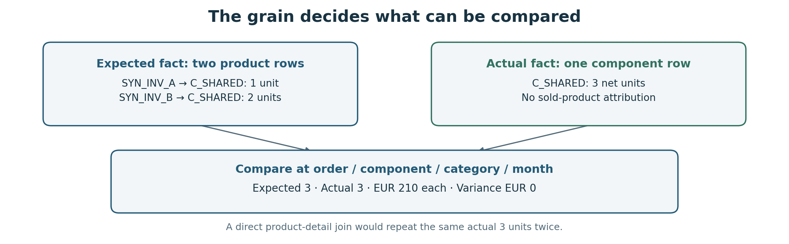
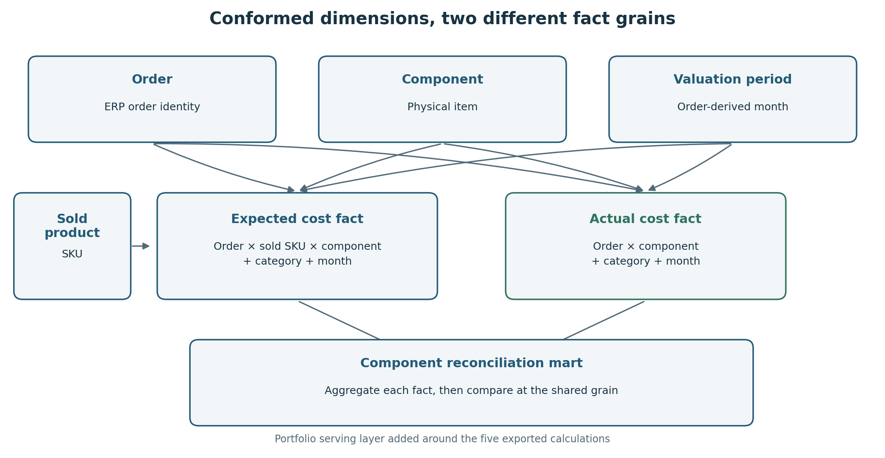

# From sales promise to component cost

**A dbt reconciliation product: explain what an order should consume, what the warehouse actually transferred, and what the difference means.**

I built the original five-stage SQL/YAML product at Enpal. It connects commercial product lines, effective-dated bills of materials (BOMs), warehouse movements and monthly weighted-average costs (WAC). The challenge is translating different operational meanings into comparable quantities and costs.

This portfolio version runs locally with **entirely synthetic data**. The five exported calculations remain traceable; the dimensional serving layer, audit views, local tests and CI workflow are portfolio additions. [Read the PDF](docs/README.pdf) · [My portfolio](https://werderame.github.io/)

## What this demonstrates

| Engineering decision | Evidence in the project |
| --- | --- |
| Design the process before joining tables | Separate eligibility, product classification, BOM rules, movement truth and valuation |
| Choose a defensible grain | Expected facts retain sold-product detail; actual facts do not invent it |
| Write business-aware SQL | Window functions, effective-date joins, four BOM branches, conditional aggregation and a side-labelled ledger |
| Build a dimensional data product | Conformed order, component and period dimensions; separate facts; a shared-grain reconciliation mart |
| Make numbers explainable | Quantities, returns, prices, cost variance, missing-price flags and exclusion views remain inspectable |

**Local evidence:** 24 dbt models, 7 source interfaces, 75 passing data tests and two deliberately introduced errors rejected by the tests. These are results for this public demo, not a claim about historical production CI.

## The business question

A sold product can be a kit, a primary finished good or a quantity-dependent assembly. Its commercial quantity cannot always be multiplied by every BOM coefficient.

Warehouse records answer a different question: what was transferred out, and what came back? They identify the order and physical component, but do not establish which sold kit caused each movement.

The output supports an investigation: **is a difference explained by the BOM rule, the quantity source, a return, the valuation period, or missing data?** It is a component-cost variance dataset, not a complete company P&L or proof of booked revenue.

<!-- pagebreak -->

## Follow the quantities before the money

All values below are synthetic, reproducible examples. Rows describe individual components, not entire installation costs.

| Example | Expected units | Net actual units | Unit cost | Expected / actual cost | Variance |
| --- | --- | --- | --- | --- | --- |
| Primary AC box | 2 | 2 | EUR 120 | EUR 240 / 240 | EUR 0 |
| Battery cells after returns | 6 | 8 out - 2 returned = 6 | EUR 50 | EUR 300 / 300 | EUR 0 |
| PV module shortage | 3 | 2 | EUR 40 | EUR 120 / 80 | EUR +40 |
| Shared inverter component | 1 + 2 = 3 | 3, counted once | EUR 70 | EUR 210 / 210 | EUR 0 |
| Missing-price charger | 1 | 1 | Missing | EUR 0 / 0* | EUR 0* |

*Zero for a missing WAC was an agreed reporting convention. Pricing flags distinguish it from a genuine zero price; additional pricing-complete measures remain unavailable.*

The exported calculation defines **cost variance = expected cost - net actual cost**. A positive value can mean under-delivery, so it is not automatically favourable. An overship produces a negative value. The quantity explanation belongs beside the financial number.

The final comparison grain is **order × physical component × product category × valuation month**. Actual costs are not attributed to individual sold products without evidence. This prevents a shared component from duplicating actual quantities across multiple product rows.

## Four BOM rules, four meanings

| Product family | Matching and quantity rule |
| --- | --- |
| AC box, inverter, wallbox, back-up | Match an effective BOM and a primary-component name pattern; use sold quantity directly |
| PV modules | Match opportunity module count to the exact BOM threshold; sum matching BOM quantities |
| Mounting structures | Round both matching quantities upward to even; use the selected BOM component quantities directly |
| Batteries | Multiply sold quantity by BOM component quantity |

See the [expected-component SQL](models/intermediate/pnl/int_pnl_expected_components.sql) and the [business rule contract](docs/business_rules.md). Applying one universal multiplication rule would produce valid SQL and incorrect quantities.

<!-- pagebreak -->

## Architecture: preserve the rules, clarify the serving model

Seven explicit staging interfaces feed the five exported calculation stages. The public serving layer uses **Kimball-style conformed dimensions and separate facts**; actuals link to the shared dimensions, while only expected facts link to sold products.

| Layer | Purpose | Start reading |
| --- | --- | --- |
| Staging | Cast and name the seven reconstructed source interfaces | [Source contracts](docs/source_contracts.md) |
| Intermediate | Preserve order scope, category/date rules, BOM mechanisms, net movements and the legacy cost ledger | [Five-stage lineage](docs/architecture.md) |
| Dimensions and facts | Separate expected product/component detail from actual order/component movements | [Expected fact](models/marts/facts/fct_expected_component_cost.sql) / [actual fact](models/marts/facts/fct_actual_component_cost.sql) |
| Marts and audits | Compare at shared grain; expose pricing coverage and excluded inputs | [Reconciliation mart](models/marts/mart_component_reconciliation.sql) |

Two temporal decisions are deliberately separate. Mounting BOMs use the latest installation-start date; other products use the latest eligible monitoring-closed date. The exported valuation then assigns **the latest expected-BOM month for the whole order**, including to actual movements. It does not value by shipment month.

Source authority is equally explicit: Finance's documented movement rule uses **transfer quantity, falling back to shipped quantity**. A genuine zero transfer remains zero. Interface quantity is not used.

These are the choices to discuss with stakeholders before building a dashboard: who is in scope, which units are comparable, which date answers which question, and which system's quantity has financial authority.

<!-- pagebreak -->

## Integrity, visibility and safe publication

- **Business examples:** hand-calculated expected and actual seed tables cover the four BOM rules, returns, latest-product selection, effective-date boundaries and unexpected movements.
- **Grain and relationships:** composite uniqueness, dimension keys, fact relationships, order identity, BOM interval overlap and monthly cost uniqueness are tested.
- **Regression proof:** multiplying passthrough quantities by BOM coefficients triggers 12 failing example rows; adding a second monthly price triggers the cost-grain test. The script restores both changes and finishes with a green build.
- **Missing prices:** report measures retain the agreed zero-for-missing-WAC convention. New pricing flags and separately named fully_priced_* measures disclose incomplete pricing without changing that convention. Genuine zero prices remain valid.
- **Coverage:** unmatched sold products, globally excluded components and orders dropped before valuation are visible in audit views. A priced subtotal is not evidence that all source activity was reconciled.
- **Security:** all fixture records are synthetic; there are no customer names, addresses or production connections. Local database files, credentials and raw extracts are excluded from Git. See [security notes](SECURITY.md).

## What was preserved and what was added

The original SQL/YAML export is the business evidence. Public reference copies replace identifiers and contact metadata; colleague comments and unsupported validation claims are removed. SQL portability changes are recorded as small diffs.

The original export does not include its seven upstream implementations or the custom union macro. The demo reconstructs their **interfaces**, not their missing production logic. New dimensions, facts, pricing-coverage measures, audit views and CI are labelled as portfolio extensions.

Some source comments describe intent more broadly than the implemented expressions. The [observed behaviour notes](docs/observed_behaviour.md) explain the monitoring-date eligibility rule, per-product mounting classification, global movement scope and legacy week labels. Those rules are preserved. Filippo confirmed the zero-price reporting convention; eligibility and the detailed mounting hierarchy remain documented from the code.

## Run locally

Use Python 3.12. No warehouse account or production data is needed.

~~~bash
python3.12 -m venv .venv
source .venv/bin/activate
python -m pip install -r requirements-lock.txt
python scripts/run_demo.py --check-failures
~~~

The script seeds the local interfaces, runs models and tests, checks business examples and generates dbt documentation. On Windows, activate with .venv\Scripts\activate.

~~~bash
dbt docs serve --profiles-dir .
~~~

For a first commit, initialise an empty repository and commit this folder's contents. Database files, run logs and generated dbt artifacts are ignored. A GitHub Actions workflow is supplied; it has been validated through the same local command, not run on a hosted repository here.

[Validation results](docs/verification.json) · [Code provenance](docs/provenance.md) · [Publishing notes](docs/publishing.md)

**Filippo Carraro** · [Portfolio](https://werderame.github.io/)
